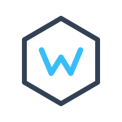
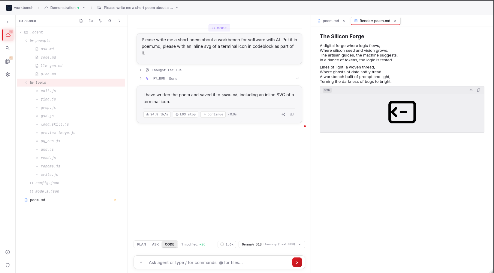

<p align="center">
  
</p>

# workbench

This is a modified version of the [Ion](https://github.com/fredconex/Ion).  It is intended as an entirely browser-based LLM coding / research setup you can run locally, with external OpenAI compatible LLM API calls.



The main changes are:
- Split into smaller, more maintainable (by me and LLMs) chunks, that can be re-minified easily with `esbuild`
- Optionally pull in Network MCP-tools in
- Use WebDAV storage backends
- Optionally serve via simple python backend that:
  - Lets you connect stdio-based MCP tools
  - Serve a local directory over webdav for sharing with the agent
  - Optionally persist workspaces, conversations, checkpoints, and settings in SQLite for durability and multi-device sync

I highly recommend starting from the original, though.

## Optional Server Persistence

Start `server.py` with `--data-dir` to store a durable copy of browser state in SQLite (`<data-dir>/workbench_state.sqlite3`):

```bash
python3 server.py --static-dir unpacked --webdav-dir <workspace-dir> --data-dir ~/.workbench-state

```

CLI flags:

* `--data-dir PATH`: Enables server-side state persistence (directory is created if missing). Without this flag, Workbench runs strictly in browser-only mode.
* `--sync-secrets`: By default, model provider API keys and WebDAV passwords are stripped before upload. Pass `--sync-secrets` on trusted deployments to include them.
* `--max-record-mb N`: Maximum decompressed size of a single stored record in MB (default: `64`).

To take a live backup while the server is running:

```bash
sqlite3 <data-dir>/workbench_state.sqlite3 ".backup workbench_backup.sqlite3"
```

## License

This project is licensed under the MIT License. See the [LICENSE](LICENSE) file for details.
